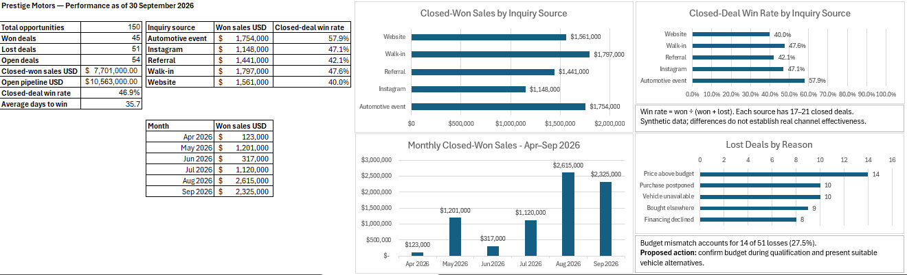
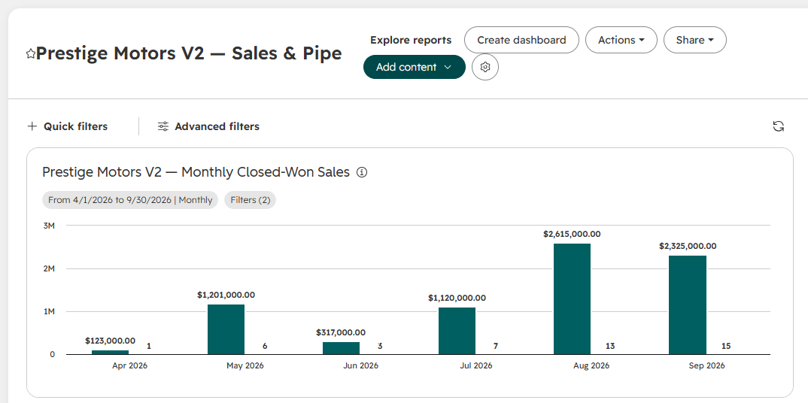
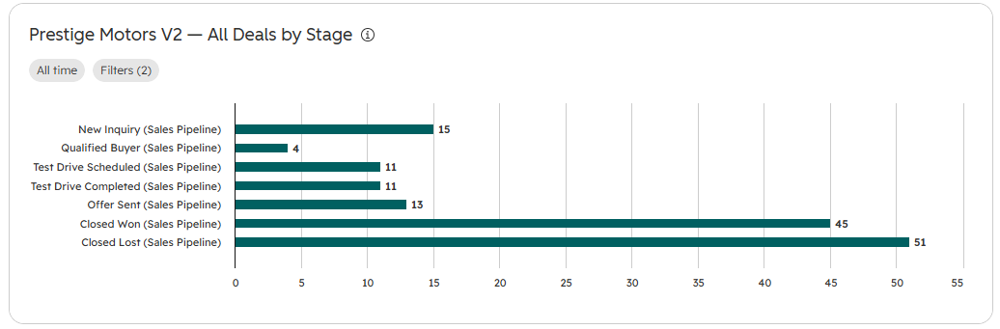
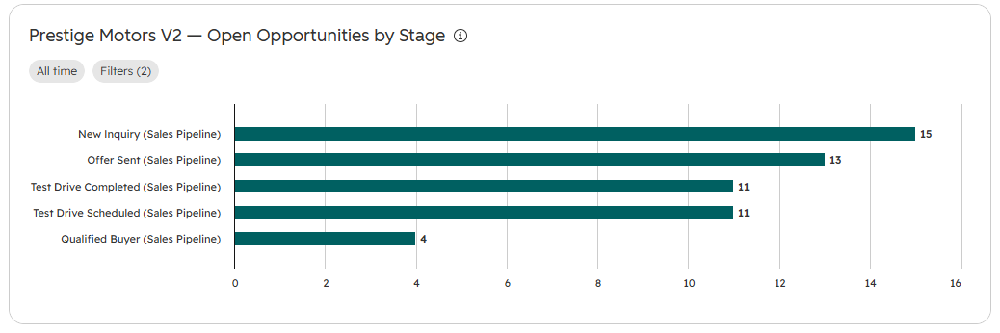
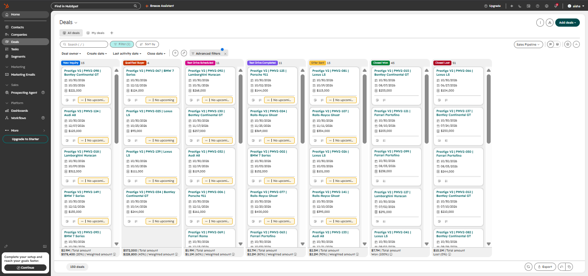

# Prestige Motors | Automotive Sales & CRM Analysis

An independent portfolio project exploring sales performance,
inquiry-source conversion and pipeline priorities for a fictional
luxury automotive dealership.

**Author:** Aisha Tellili  
**Tools:** Excel · SQL Server · HubSpot  
**Dataset:** 150 synthetic deals  
**Reporting snapshot:** 30 September 2026  
**Currency:** USD

> This project uses fictional data for learning and demonstration.
> Findings describe this dataset, not the automotive market.

## Business questions

- How are closed-won sales performing over time?
- Which inquiry sources have the highest closed-deal win rates?
- Why are opportunities being lost?
- Which open opportunities should receive follow-up attention?

## Key findings

| Metric | Result |
|---|---:|
| Total opportunities | 150 |
| Closed-won deals | 45 |
| Closed-lost deals | 51 |
| Open opportunities | 54 |
| Closed-won sales value | $7,701,000 |
| Open pipeline value | $10,563,000 |
| Closed-deal win rate | 46.9% |

**Win rate** = won deals ÷ (won + lost deals).
Open opportunities are excluded from this calculation.

Open pipeline value represents potential deal value,
not guaranteed future sales.

## What I built

### Excel | Data preparation and management reporting

- Prepared and validated deal records.
- Built pivot tables and charts for monthly sales,
  inquiry sources and loss reasons.
- Created a management summary and follow-up priorities.
- Documented business rules, findings and recommendations.

[Download the Excel workbook](excel/prestige_motors_analysis.xlsx)

### SQL Server | Business analysis queries

Developed a SQL analysis script to explore sales, deal outcomes,
inquiry-source performance and pipeline priorities.

[View the SQL script](sql/prestige_motors_analysis.sql)
[View SQL query results](screenshots/)

### HubSpot | CRM implementation and reporting

- Imported 150 synthetic deals and mapped their properties.
- Used Project Deal ID to distinguish project records.
- Configured three reports:
  - Monthly Closed-Won Sales
  - All Deals by Stage
  - Open Opportunities by Stage
- Checked CRM report figures against the source analysis.

## Dashboard previews

### Excel management summary

Sales performance, inquiry-source comparisons and loss reasons.

### HubSpot monthly closed-won sales

Monthly sales value and won-deal counts from April to September 2026.

### HubSpot deal distribution

All 150 synthetic opportunities grouped by their current stage.

### HubSpot open opportunities

The 54 open opportunities grouped by stage.

### HubSpot CRM board

A view of the imported project deals within the sales pipeline.

## Proposed business actions

- Prioritize review of the 13 opportunities at Offer Sent.
- Investigate budget qualification: “Price above budget”
  accounts for 14 of 51 lost deals.
- Explore inquiry-source differences before making budget decisions.
  Source samples are small, and acquisition costs are unavailable.

These are recommendations from the analysis, not measured
business improvements.

## Validation and lessons learned

Matching overall totals did not initially produce matching monthly
results in HubSpot. A reporting time zone difference shifted a deal
across a month boundary.

After aligning the account reporting time zone, the monthly
closed-won figures matched the source analysis, including:

- August: $2,615,000
- September: $2,325,000

Exports labelled `before_timezone_fix` are retained as troubleshooting
evidence and should not be treated as the corrected monthly results.

## Repository guide

| Folder | Contents |
|---|---|
| data | Source dataset and HubSpot import file |
| docs | Synthetic-data generation notes |
| excel | Final analysis workbook |
| screenshots | Excel dashboard, HubSpot reports and CRM board |
| sql | SQL analysis script |
| validation | Supporting CRM exports |

## Limitations

- The dataset is synthetic and contains only 150 opportunities.
- Results reflect a fixed snapshot rather than ongoing performance.
- Stage counts show the current distribution, not historical
  movement through a sales funnel.

